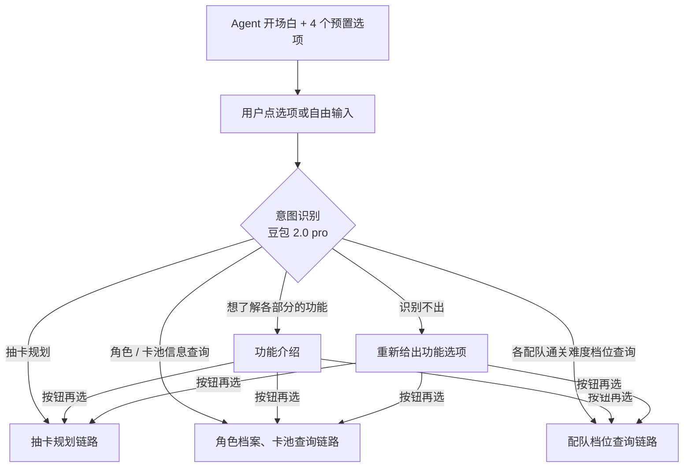
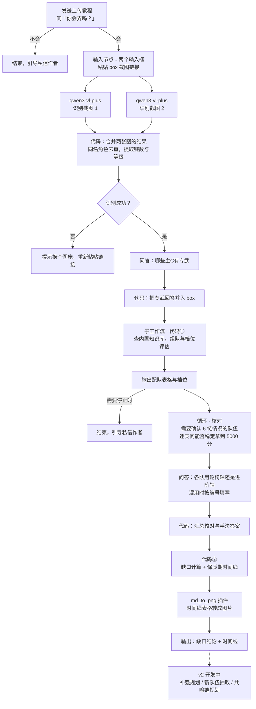
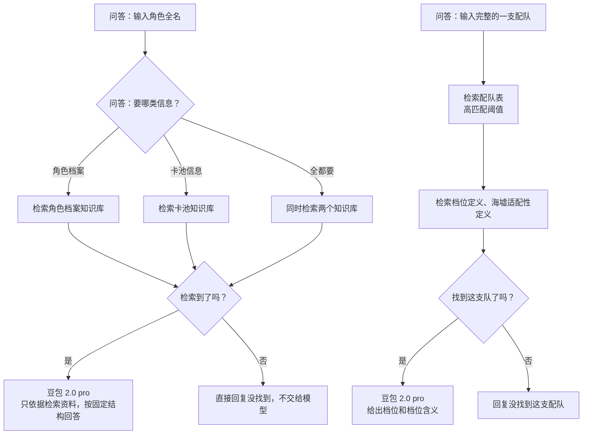

# 大雪绒规划 · 《鸣潮》抽卡规划 Agent

附带角色档案、卡池信息和各配队通关高难副本的难度档位查询。

帮《鸣潮》玩家根据自己已有的角色及其共鸣链、专武情况，组出综合实力最强的一套队伍，并算清楚离拿满高难副本奖励还差什么、现有队伍还能用多久。

**▶ 在线体验：[扣子商店 · 大雪绒规划](https://www.coze.cn/store/agent/7673147227493761087?bot_id=true)**（需登录扣子，可用抖音扫码登录）

> 源码与数据因计划商业化暂不公开，可在面试中现场演示扣子工作流。

---

## 没玩过《鸣潮》？没关系！先看这 8 个词，不难理解的～

| 术语 | 意思 |
|---|---|
| 星声 / 抽卡资源 | 游戏里用来抽角色的货币，数量有限，花了不能退 |
| 主C | 队伍里负责主要伤害的核心角色。一支队伍有 3 人：1 名主C + 2 名队友 |
| 专武 | 角色的专属武器，提供最适合这个角色的属性加成，同样要靠抽卡获得 |
| 共鸣链 | 重复抽到同一角色获得的强化，最多 6 层，每层的增益不同。只有角色本体时是 0 链，最高 6 链 |
| 深塔 / 海墟 / 矩阵 | 定期刷新的高难副本，打得好能拿到大量星声，需要多支实力足够强的"达标队伍"，其中矩阵要求最高，需要 4 支 |
| box | 玩家拥有的所有角色，以及每个角色的共鸣链和专武情况 |
| 复刻 | 限定角色重新开放抽取，具体时间不确定 |
| 轮椅轴 / 进阶轴 | "轴"指一支队伍的出招顺序和手法。轮椅轴操作简单，适合手残党；进阶轴操作复杂、上限更高，适合高手 |

> 不知道先试哪个？可以先点「想了解你各部分的功能再多一点」，看完功能介绍再选。

## 3 分钟体验：抽卡规划

这条链路用到：视觉模型识别 box 截图、内置知识库（配队档位数据压缩后写进代码节点，由代码直接查表）、代码组队与计算、Markdown 表格转图片。

**示例 box**：一个示例账号的全部角色。不用下载图片，把下面两条链接复制给 Agent 就行；想看截图的话，点开链接就能看到。

- 示例截图 1：https://s41.ax1x.com/2026/11/12/pnIWrI1.jpg
- 示例截图 2：https://s41.ax1x.com/2026/11/10/pn5VarT.png

1. 打开上面的在线体验链接，登录扣子。
2. 在开场白下方的选项里点「抽卡规划」。
3. Agent 会发来上传 box 的教程，并问「怎么样？你会弄吗？」，点「会」。
4. 页面会出现两个输入框，把上面两条链接分别粘贴进去，点「提交」。
5. 提交后，Agent 会识别截图里的角色和共鸣链，大约需要 30 秒，中途请不要打断它哦。
6. 问到哪些主C有专武时，回复「都有」或「都没有」即可。
7. Agent 根据 box 和专武情况组队，给出配队表格和每支队的通关难度档位。
8. 如果被问到某支队伍能不能在矩阵第一波怪中稳定拿到 5000 分，任选一个答案即可。
9. 被问到这些队伍一般用什么轴时，选「每支队都用轮椅轴」或「每支队都用进阶轴」流程最短；也可以选「有的用进阶轴，有的用轮椅轴/有的记得有的不记得」，再按提示随便填几个队伍编号（例如 1、2）。
10. Agent 会算出这个 box 离拿满高难副本奖励还差什么，以及现有队伍还能用到哪个版本，大约需要 20 秒。

你会看到：配队表格（每支队的通关难度档位）、离拿满奖励还缺什么，以及现有队伍还能用到哪个版本的时间线。

## 1 分钟体验：角色档案、卡池信息查询（RAG）

1. 打开在线体验链接并登录扣子。
2. 开场白之后，点选项里的「角色信息/卡池信息查询（注意，没有内鬼消息哦）」。「内鬼消息」指未经官方公布的爆料。
3. 按提示输入一位角色的全名，比如「琳奈」「西格莉卡」「绯雪」，任选其一发送。
4. 被问到「你想要知道他/她的哪一类信息呢？」时，从三个选项里任选一个，Agent 会整理出对应的信息，大约需要 20 秒。

## 1 分钟体验：各配队通关难度档位查询（RAG）

1. 打开在线体验链接并登录扣子。
2. 开场白之后，点选项里的「各配队通关难度档位查询」。
3. 按提示输入完整的一支配队（三位角色都要写），比如「爱弥斯+达妮娅+千咲」或「爱弥斯+琳奈+莫宁」，任选其一发送。
4. Agent 会给出这支队伍在主C有无专武、不同共鸣链情况下，通关深塔、矩阵和海墟的难度档位，以及每个档位的含义，大约需要 20 秒。

---

## 项目背景

《鸣潮》玩家需要用有限的抽卡资源获取能通过高难副本的角色，而高难副本又产出大量抽卡资源，规划的好坏直接决定玩家能否通关高难副本，进而影响后续抽卡资源的积累。现有攻略多只针对单个角色给出推荐，无法结合玩家的box情况给出抽卡规划；通用大模型则依赖社区讨论作答，既无法辨别信息真伪，多步计算也不稳定，难以给出个性化、可靠的规划。

## 整体流程

### 入口与分流

开场白和 4 个选项在 Agent 层。用户点选项（或自由输入）后进入对话流，由意图识别节点分到不同链路。

### 抽卡规划链路

除了用视觉模型识别截图，其余判断和计算都在代码节点里完成，组队时直接查内置知识库。

### 查询链路（RAG）

检索不到时直接回复没找到，不把空结果交给大模型。

## 关键设计决策

### 1. 判断用代码，措辞用模型

组队是带约束的组合优化：每个角色在所有队伍里只能出现一次（少数通用队友可以出现两次），还要在多条优先级之间取舍。让大模型来配队，它会给出一套看起来合理、但违反约束或并非最优的结果，而且错得很隐蔽，用户看不出来。跨大版本推算队伍还能用多久，大模型也很容易算错。

所以在抽卡规划链路里，除了用视觉模型识别截图，组队、核对、缺口计算、保质期推算，连最终输出的文字都由代码节点完成；大模型只负责意图识别，以及在查询功能里依据检索资料组织回答。

### 2. 帮用户算成本，而不是替用户做决定

抽卡资源花了就收不回来，所以决定权要留在用户手里。Agent 输出每条路径要花多少、能用多久，选哪条由用户决定。

### 3. 用区间档位，而不是"能过 / 不能过"

通关难度用 A–D 四档区间评级，不给二元结论，也不给精确的伤害数值。玩家的练度和操作差异很大，精确数字只会带来虚假的精确感。

### 4. 结构化输入

把自由咨询拆成固定按钮和必填字段，降低模糊提问、字段缺失和意图识别错误带来的风险。核对阶段只认按钮：用户打字而不点按钮时按默认值处理，不进入答疑。

### 5. 同一份配队数据，两种知识库用法

组队要在玩家的全部角色里找出最优的一套队伍，需要把所有候选队伍都看一遍，并精确匹配每支队在不同共鸣链、专武情况下的档位。向量检索每次只召回少数几条结果，会漏掉候选队伍，还可能把相似的配队混在一起。所以组队用的配队档位数据被压缩后内置进代码节点，由代码全量查表，结果确定、可以测试。

查询功能面对的是用户的自由提问，用扣子知识库做检索更合适：混合检索加重排序，检索结果为空时直接回复没找到，不交给大模型自由发挥。

### 6. 代码在本地开发和测试，再打包进扣子

组队、核对、缺口这些代码节点不在扣子里手写：规则模块、配置和档位数据放在本地仓库里开发并跑测试，再用打包脚本压缩合成扣子的代码节点。规则和按钮文字全部写在配置文件里，改规则只需要改配置、重新打包，不用去扣子里逐个节点修改。扣子的代码框大约只能放 3 万字符，所以打包时把规则模块和数据用 zlib 压缩、base64 编码后写进节点，运行时先校验 sha256 再解压执行。

## 踩坑记录

### 1. 知识库检索"串角色"

- **现象**：查询角色 A，返回的却是角色 B 的数据。
- **原因**：向量检索命中了关键词密度很高的角色档案 Word 文档，而不是本该命中的卡池 Excel。
- **修复**：把 Excel 按角色名重组为一行一个角色，并改用混合检索；同时在提示词里要求模型先核对资料里的角色是不是用户问的那个，不一致就不套用。
- **结论**：数据要按查询的主键（角色名）组织，而不是按次要字段（版本号）组织；结构化的游戏数据更适合混合检索，而不是纯向量检索。

### 2. 直接发截图，视觉模型读不到

- **现象**：用户在对话里直接发 box 截图时，视觉模型拿不到图片。
- **原因**：平台只把图片的文件 ID 传进工作流，而视觉模型需要一个能访问的图片链接。
- **解决**：改成让用户把截图上传到图床、粘贴图片链接，两张截图对应两个输入框；教程里给出三个免注册图床和逐步操作说明，解析失败时提示换一个图床重试。
- **代价**：用户多了一步操作。这是平台限制下的取舍，以后自建前端时可以去掉这一步。

## 版本状态

- **v1（已上线扣子商店）**：box 截图识别、组队与档位评估、用户核对、缺口计算、保质期时间线、角色 / 卡池信息查询、配队通关难度查询
- **v2（开发中）**：配队补强规划、新队伍抽取规划、共鸣链抽取规划

## 技术栈

- **平台**：扣子（coze.cn）对话流 + 子工作流
- **运行时模型**：豆包 2.0 pro（意图识别、查询功能的回答）、qwen3-vl-plus（box 截图识别，通过通义千问插件调用）
- **插件**：通义千问多模型集合、Markdown 转换器（md_to_png）
- **知识库**：内置知识库（配队档位数据，压缩后写进代码节点，供组队查表）；扣子知识库（角色档案、卡池一览表、配队一览表，混合检索 + 重排序，供查询功能使用）
- **代码节点**：Python，本地开发与测试后打包上传
- **开发工具**：Claude Opus 5.5（方案设计、规则整理）、Claude Code（Sonnet 5.5 / Opus 5.5，编写代码节点，vibe coding）
